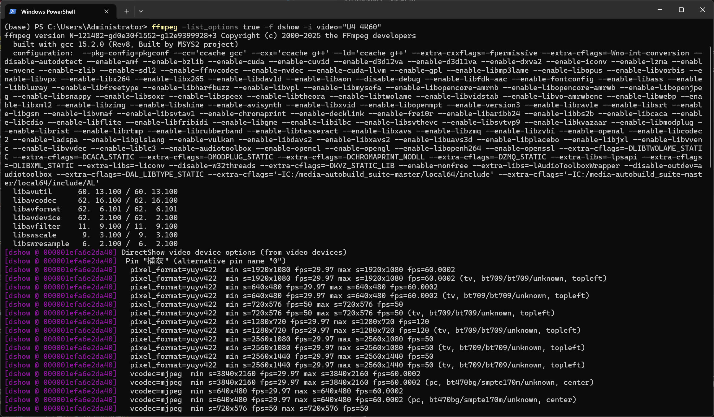
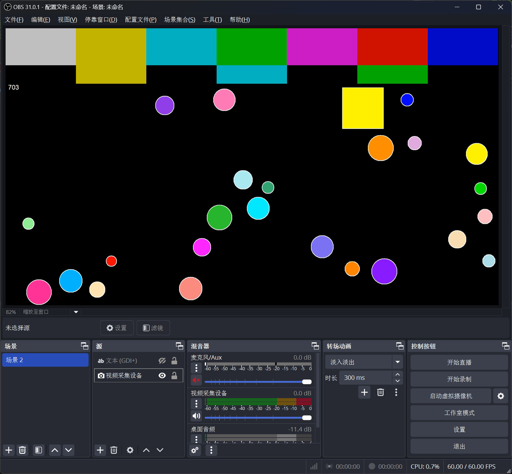
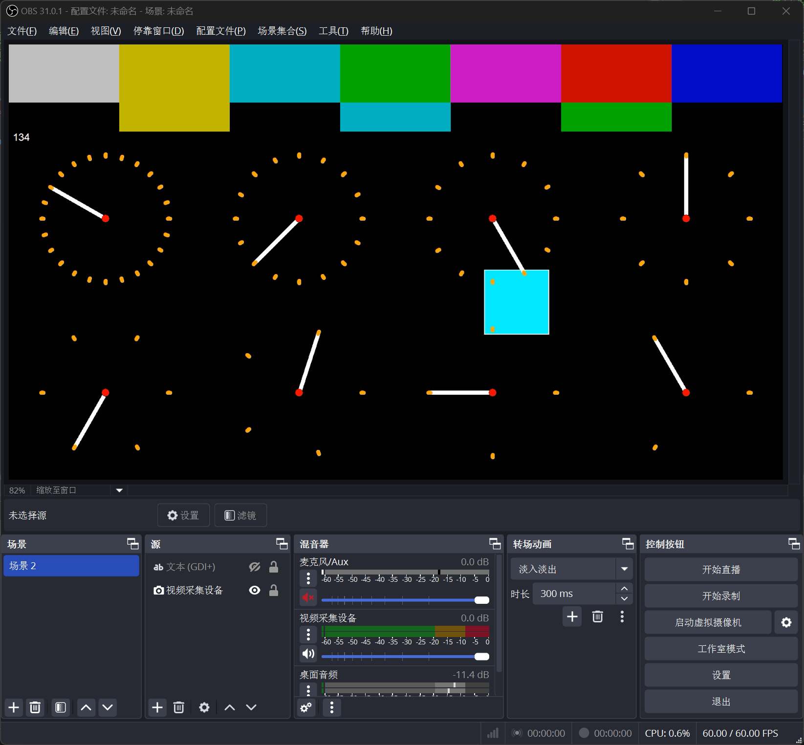
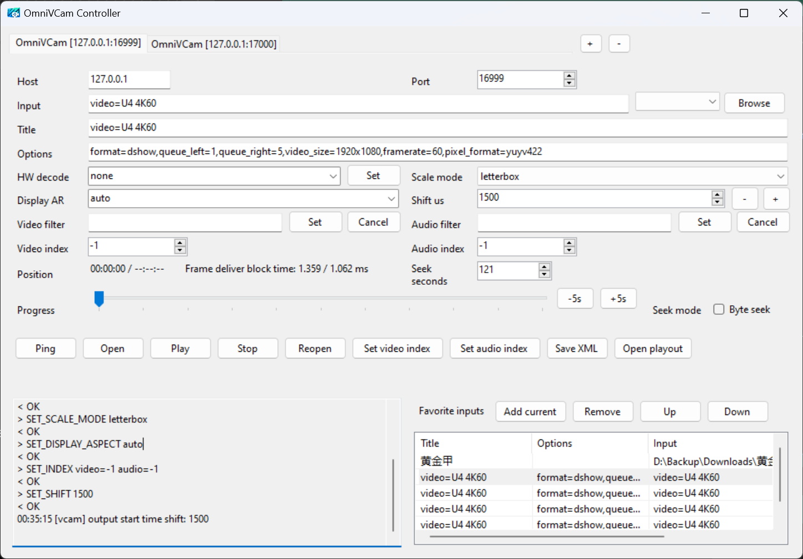
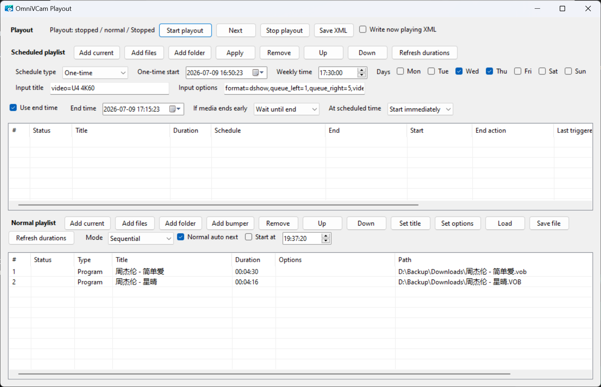

# OmniVCam Virtual Cam

[简体中文](README.zh-CN.md)

OmniVCam is a Windows DirectShow virtual camera. It can output local media files, DirectShow capture devices, OBS virtual-camera shared memory, and built-in test cards as a camera device. `OmniVCamController.exe` is the WinForms controller used to play inputs, tune playback options, and run playout playlists.

The project contains two main parts:

- `OmniVCam`: the DirectShow virtual camera DLL. It handles decoding, filtering, A/V sync, and output.
- `OmniVCamController`: the controller UI. It connects to the virtual camera TCP control server, default `127.0.0.1:16999`.

## Features

- Play local media files and arbitrary FFmpeg inputs.
- Play DirectShow devices such as capture cards or OBS Virtual Camera, either through FFmpeg or the native `<DSHOW>` capture input.
- Native `<DSHOW>` capture configuration: enumerate devices and formats, select video/audio pins, configure Crossbar routes and analog-device property pages, use device timestamps, and request an audio buffer size.
- Read OBS virtual camera shared-memory input with `<OBSVCAM>`.
- Built-in test cards: `<TESTCARD>`, `<TESTCARD2>`, and `<TESTCARDCAL>` (QR calibration).
- Per-input options such as `seek_time`, stream indexes, filters, queue settings, and input format.
- Manual playback controls: play/pause toggle, stop, reopen, seek, byte seek, progress drag, filters, display aspect, scale mode, and output time shift.
- Runtime changes for scale mode and display aspect during playback.
- Favorite inputs list for reusable input/options pairs.
- Multiple connection tabs, each with independent host/port, input settings, playlists, and favorites.
- Controller UI localization through standard `.resx` resources, currently English, Simplified Chinese, and Traditional Chinese.
- Playout window with separate scheduled and normal playlists.
- One-time and weekly scheduled playlist items with editable title, options, start/end behavior, and live Apply.
- Bumper items in normal playlist for interstitial content.
- Drag-and-drop support: drop files onto the input field or playlist.
- Built-in log viewer displaying FFmpeg log messages forwarded via TCP.
- Frame deliver block-time stats displayed in the position area.
- Optional now-playing XML output for vMix and other external tools.
- Automatic saving of UI settings, playlists, scheduled playlist, and favorite inputs to `OmniVCamController.xml`.

## Install

1. Copy the release files to a fixed directory, for example `D:\OmniVCam`. Keep `OmniVCam.dll`, FFmpeg DLLs, config files, and the controller together.
2. Register the virtual camera DLL from an elevated command prompt:

   ```bat
   cd /d D:\OmniVCam
   regsvr32 OmniVCam.dll
   ```

3. Select `OmniVCam Virtual Camera` in OBS, vMix, conferencing software, or other camera clients.

To unregister:

```bat
cd /d D:\OmniVCam
regsvr32 /u OmniVCam.dll
```

## Multiple Instances

OmniVCam supports up to 4 simultaneous virtual camera instances. Each instance has its own CLSID and reads its own `config.ini` via an environment variable:

| Instance | Environment Variable | Config Path Example |
| --- | --- | --- |
| OmniVCam | `OMNI_VCAM_CONFIG` | `D:\OmniVCam\config.ini` |
| OmniVCam2 | `OMNI_VCAM_CONFIG2` | `D:\OmniVCam2\config.ini` |
| OmniVCam3 | `OMNI_VCAM_CONFIG3` | `D:\OmniVCam3\config.ini` |
| OmniVCam4 | `OMNI_VCAM_CONFIG4` | `D:\OmniVCam4\config.ini` |

To run multiple instances, copy the DLL and config files into separate directories, set each environment variable to point to the corresponding `config.ini`, and register each DLL instance. Each instance exposes a distinct camera device name (e.g. `OmniVCam Virtual Camera`, `OmniVCam2 Virtual Camera`, etc.).

## Controller Basics

Run `OmniVCamController.exe`. The default target is `127.0.0.1:16999`; the port must match `tcp_port` in `OmniVCam/config.ini`.

### Connection Tabs

The controller supports **multiple connection tabs**. Each tab maintains its own host, port, input settings, playlists, favorites, and log text. Use the `+` button to add a tab and the `-` button to remove one. Tab titles display the connection endpoint.

Main controls:

- `Host` / `Port`: TCP control endpoint.
- `Input`: the input to play. It can be a file path, URL, DirectShow input, or a special input such as `<TESTCARD>`, `<TESTCARD2>`, `<OBSVCAM>`, or `<DSHOW>`. A quick-select dropdown provides quick access to special inputs.
- `Title`: display title used by playlists and now-playing XML. If blank, the controller derives a title from the input.
- `Options`: FFmpeg/open-input options for the current input, for example `seek_time=14,video_filter='bwdif=1'`.
- `Browse`: select a local media file.
- `Open`: open/play the current `Input` with current `Options`.
- `Play`: play the current `Input`, or toggle **Pause/Play** while playback is active or paused.
- `Stop`: stop playback and stop playout.
- `Reopen`: reopen the current input.
- `Ping`: test the TCP connection.
- `Video filter` / `Audio filter`: set or cancel global filters.
- `Auto deinterlace`: automatically applies the selected deinterlace filter only when no `video_filter` is set and an interlaced frame is detected. Mixed progressive/interlaced streams are handled per frame: progressive frames bypass the auto filter, interlaced frames go through it.
- `Deinterlace filter`: automatic deinterlace filter, `bwdif`, `yadif`, or `w3fdif`.
- `HW decode`: set hardware decode mode: `none`, `dxva2`, `d3d11va`, `cuda`, or `qsv`.
- `Video index` / `Audio index`: select input stream indexes. `-1` means auto.
- `Seek seconds`: seek by absolute seconds.
- `Progress`: drag to seek. With `Byte seek` enabled, the progress bar seeks by file byte percentage. Quick `-5s` / `+5s` buttons are available beside the progress bar.
- `Shift us`: output frame timing shift in microseconds.
- `Scale mode`: output scaling mode (`letterbox`, `fill`). Can be changed at runtime.
- `Display AR`: display aspect ratio (`auto`, `16:9`, `4:3`, `1:1`). Can be changed at runtime.
- `DirectShow` / `Camera`: opens the native `<DSHOW>` capture setup dialog. It is enabled for the `<DSHOW>` input and writes the required options automatically.
- `Open playout`: open the separate playout window.
- `Language`: select Auto, English, Simplified Chinese, or Traditional Chinese. Restart the controller after changing this setting.

### Native `<DSHOW>` Capture Input

`<DSHOW>` is the native DirectShow capture path. Unlike the `format=dshow` FFmpeg input, it builds a DirectShow graph in OmniVCam and sends captured frames through the normal video/audio filter and output pipeline. Compressed samples are copied into bounded real-time queues and decoded on dedicated worker threads, so codec work does not block the DirectShow sample callback.

1. Select `<DSHOW>` in **Input**, then choose **DirectShow** → **Camera**.
2. Select a video device and capture format. Audio is optional; it can come from the capture device or a separate audio device.
3. Optionally select video/audio Crossbar routes, open Crossbar/TV tuner/TV audio property pages on playback, use video/audio device timestamps, and request an audio buffer size.
4. Choose **OK** to fill `Input`, `Title`, and `Options`, or **Open** to apply and start playback immediately.

The controller enumerates compatible pins and formats and stores device names and pin IDs as UTF-8 Base64 options, so the generated options should normally be kept intact. `<DSHOW>` supports video-only, audio-only, and combined capture. Standard per-input options still apply, including `video_filter`, `audio_filter`, `queue_left`, `queue_right`, and `queue_center`.

For programmatic control, the native options are `dshow_device_b64`, `dshow_pin_b64`, `dshow_format`, `dshow_audio_device_b64`, `dshow_audio_device_type` (`0` for a video-capture device, `1` for an audio device), `dshow_audio_pin_b64`, `dshow_audio_format`, `dshow_xbar_video_in`, `dshow_xbar_video_out`, `dshow_xbar_audio_in`, `dshow_xbar_audio_out`, `dshow_crossbar_dialog`, `dshow_tv_tuner_dialog`, `dshow_tv_audio_dialog`, `dshow_use_video_device_timestamp`, `dshow_use_audio_device_timestamp`, and `dshow_audio_buffer_size` (milliseconds). Device and pin values use UTF-8 Base64; omitted format/route values select the device default.

### Log Viewer

The main window includes a **log viewer** panel on the left side that displays FFmpeg log messages forwarded from the virtual camera instance over TCP. Log output is auto-scrolling and capped at a maximum line count. Each connection tab preserves its own log text independently.

### Drag and Drop

- Drag files onto the **Input** field to load them for playback.
- Drag files onto the **Normal playlist** or **Scheduled playlist** to add them as items.

## Interactive Playback

Select **Interactive Playback** in the controller's main window to open the separate interactive-playback window. Media-library and project settings belong to the active connection tab and are saved in `OmniVCamController.xml`; the queue and operation history show runtime activity.

### Media and Projects

1. Add media files to the media library, then edit their titles, input options, and **Loop playback** setting as needed. A looping item is sent to the virtual camera with the `loop=1` input option.
2. Add an interactive project, then add one or more **Media combinations**. Select a combination on the left and arrange its library items on the right; combinations can be duplicated, removed, and moved up or down. For example, one F1 project can contain `A → B`, `A2 → B`, and `A2 → B2`.
3. Assign an optional global hotkey, select the project's trigger mode, and choose **Random** (default) or **Sequential (repeat in order)** for combination selection.
4. Trigger the project with its hotkey, the project's button, **Trigger**, or by double-clicking it.

Each trigger selects one whole combination. Random selection can repeat the previous combination; sequential selection advances through the configured order and wraps back to the first combination. Each project tracks its own position, which starts at the first combination after configuration reload or project editing. Existing single-sequence projects load as one combination. The Operations panel records the actual media sequence selected for each trigger.

Random mode also supports the following settings; sequential selection remains unchanged:

- **Weight**: select a combination and set its relative weight from 1 to 1000 (default 1). Two eligible combinations with weights 9 and 1 have approximately 90% and 10% selection probabilities.
- **Exclude last N selections**: a project setting, with 0 disabling it. The most recent N successfully selected combinations are excluded. The effective limit is the current available combination count minus one; a single available combination may repeat.
- **Cooldown**: each combination can have a cooldown of 0–86400 seconds; 0 disables it. Timing starts when the combination is selected for a playback request, including requests waiting in the queue.

Recent and cooling-down combinations are excluded before weighted selection. If none qualify, the trigger is skipped and logged, preserving current playback and queued requests. Defaults retain equal-probability random selection with repeats and no cooldown. Projects have independent history and cooldown state. Only settings are persisted; reloading configuration, saving project edits, or deleting media that changes project contents resets selection state. Copied projects and duplicated combinations start without runtime history or cooldown.

Use **Add file group** in the media library to create a reusable item containing several files. In its editor, add/remove/reorder files and set **Play on each trigger** to **One file** (default) or **All files**:

- **One file**: sequential mode cycles through the files across uses. Random mode selects a file on each use; **No repeats within a round** selects every file once before starting a new round. Repeats across round boundaries are allowed unless recent-N exclusions are configured.
- **All files**: sequential mode expands the group in list order; random mode shuffles the complete list. Every file is queued once, followed by any remaining media in the project.

File-group selection is independent of the project's media-combination selection. Only groups in the selected project combination advance their selection progress. A group's options apply to each selected file. Use the media library's loop toggle to repeat the entire file group. Sequential looping cycles through the files; random looping continues selecting or reshuffling files using the group's random and no-repeat settings. A queued follow-up item takes over after the current pass. A newly triggered project finishes the group pass already playing and replaces any prefetched repeat pass. The library shows each group's file count, selection mode, and trigger scope; operation logs show the actual selected filenames. Files and settings are saved with the connection configuration; reloading configuration or saving edits to a group resets its selection progress.

Adding or editing projects during playback preserves the current queue. Already triggered playback keeps its selected files, loop settings, and interrupt protection; subsequent triggers use the edited configuration. Backend completion events are processed in order and matched by `frame_id` so delayed events from an earlier invocation of the same file cannot skip the current one.

The controller checks `STATUS actual_input` every second against actual playback, independently of disconnect notifications; prefetched `input` does not identify the current output. After 10 continuous seconds without confirmation (including mismatched, stopped, or unavailable status), it sends `PLAY` for the pending/queued next item while retaining the remaining queue, or takes the next waiting project if no item is queued. Matching paused output also resets the timeout. Failed or unverified recovery keeps retrying the same selected item instead of consuming the queue; normal prefetch resumes only after actual output is confirmed. If no next item exists, the stale playing state is released. The timeout is checked during status polling, so connection and command timeouts affect recovery latency.

File groups also support **Random number of files** with an inclusive minimum/maximum range, such as 3–5. Each use draws a new playback count, which may exceed the available file count: three files can supply 30–50 playback occurrences. Sequential selection wraps around; random selection continues using relative weights, recent-N exclusions and optional no-repeat rounds. With no-repeat rounds enabled, exhausting the pool starts another round until the playback count is filled; rounds can span uses. **Probability / recent exclusions** sets relative per-file weights and a recent-N exclusion window for random selection. Weights 1 and 3 give base probabilities of 25% and 75%; probabilities are recalculated after excluding recent files. N is capped at file count minus one. For all-files playback, weights affect shuffle order while every file still plays once.

**Start / end files** provides two optional pools, each selecting one file by independent sequential rotation or random rules. Playback becomes one start file → selected middle files → one end file. Start, middle and end have separate weights, recent-N settings and selection progress. With either boundary configured, looping repeats only the middle; the start runs once and the end runs when yielding. Groups without start/end files retain their existing whole-group loops and protection.

Groups with start/end files offer four interruption policies:

- **Default** protects start/end and finishes the current middle before the end. **Minimum completed middle files** defaults to 0: an interruption during the start finishes the start, skips middles and plays the end. With a minimum of 3, completed middles count toward the guarantee; enough remaining middles must finish to reach 3 before the end. A smaller selection is expanded to meet the minimum, which may also exceed the middle pool size. Each completed playback occurrence counts separately, including repeated source files.
- **Allow interruption at any time** follows the project's PLAY / PLAY_NEXT behavior and discards remaining middles and the end.
- **Interrupt middle immediately; protect start / end** can jump from a middle straight to the end; start and end must finish.
- **Never interrupt** finishes the start, every selected middle in the current pass and the end before the destination. A looping group completes its current pass and end rather than starting another pass.

Enable **Ignore repeat triggers while playing** on an interactive project to discard repeat triggers while that same project is playing, including combo hits, without interrupting or queuing another invocation. It uses project identity across start, middle, end and looping playback; different projects sharing a name or media are unaffected. A project only waiting in the queue can still be triggered again. The option defaults to off, is saved per connection, and is preserved when copying projects.

Enable **Combo hits** on an interactive project to add one middle playback whenever the same project is triggered during its start or middle phase. The current media group and OBS lifecycle are retained; the start does not repeat and the reserved end stays last. During the start, only Allow interruption at any time switches immediately to a combo middle; all other policies finish the start and then play combo hits in trigger order. During a middle, Default and Never interrupt finish the current file before combo hits; the other two modes switch immediately. Original remaining middles are retained, so a finite run selecting 5 middles with 3 accepted combo hits plays 8 middles in the waiting modes, assuming no other interruption. Minimum-count padding is included in the original count. Loops have no fixed total; immediate modes can truncate middles, so completed-file counts differ. Triggers during the end or for another project follow normal project playback.

Enable **Do not interrupt** on a single file or file group in its editor, or select library items and use **Toggle interrupt protection**. A new project waits for the protected file to finish, or for the current pass of an **All files** group, then takes over and skips the old project’s remaining media. For example, if A is protected and B is interruptible, a trigger during A starts the new project immediately after A ends. A **One file** group protects only the selected file. Looping media yield after the current file or group pass. This applies to both PLAY and PLAY_NEXT triggers; explicit stop and clear commands still end interactive playback immediately.

The two trigger modes are:

- `PLAY_NEXT` (default): queues the sequence and switches at natural input boundaries for seamless playback. In the example above, the controller queues A, then B, and finally leaves D looping.
- `PLAY`: immediately interrupts current playback and starts the first item in the project. The remaining items are then advanced with `PLAY_NEXT`.

### Consecutive Triggers and Looping

Projects can be triggered repeatedly without waiting for the current sequence to finish. Normal items retain their order in the queue, while a looping tail is treated as a replaceable destination instead of being allowed to block later actions. For example, if D is currently looping, trigger `B → C → D (loop)` and then trigger `E (loop)`; the resulting sequence is `B → C → E (loop)`.

Looping is performed inside the virtual-camera backend. At EOF, it drains the current packet/decoder/filter queues, seeks the input to the beginning, assigns a new `input_frame_id`, and resumes timing only after audio and video reach the same new boundary. An internal loop restart is therefore not reported as completion of the interactive item. Receiving `PLAY` cancels the loop immediately; receiving `PLAY_NEXT` cancels it after the current pass so that the queued item can take over cleanly.

The media library and interactive project list have Up/Down buttons to arrange the selected item. The saved XML retains this display order; existing media references, project hotkeys, combination-selection progress and playback queues keep their meaning.

The main **OBS operations** panel and the playout window each offer **Switch scene** for the selected or typed scene, without applying source visibility actions. In the interactive project editor, **Project OBS scenes...** and **Combination OBS scenes...** configure start and end scenes. Each nonempty combination field overrides its corresponding project field; blank combination fields inherit the project, and blank project fields inherit their group. All OBS actions, including scheduled playback, source visibility and interactive scenes, use the OBS URL and password in the main window. The playout window has no separate connection settings. Interactive group, project and combination dialogs reuse the main window’s refreshed scene list without another connection. Refreshing an interactive dialog also updates the shared list in the main and playout windows. Existing names and blank inheritance remain unchanged; names can also be typed directly. Settings are saved per connection and preserved when copying projects or combinations. The interactive window’s **Group OBS scenes...** button configures default start/end scenes for projects in the current group. Each action resolves independently in this order: media combination > project > group; blank inherits the next level, and all blank means no action. Groups save their settings independently. The project list shows effective start/end scenes, numbered to match combinations when they differ. Group settings reuse the main window’s scene catalog, and accepted triggers retain their scene snapshots after edits or group switches.

**Group OBS scenes...** also provides separate **Scene on entering group** and **Scene on leaving group** fields. When the group selection successfully changes, the controller queues the old group’s exit scene followed by the new group’s entry scene. Opening or reopening the interactive page also sends the current group’s entry scene once, before starting its default media; activation of an already open page does not repeat it. These actions are independent of project scene inheritance and do not wait for transition videos or protected media to finish. Manual selection, group shortcuts and sequential/random switching share this behavior, with or without a transition video. Reselecting the current group, selecting an unknown group, or rejecting a switch because transition media is missing sends neither action; blank fields do nothing. OBS requests run asynchronously without blocking video playback, and rapid switches retain the accepted order and per-switch scene/connection snapshots.

The main **Enable OBS operations** switch is saved per connection and defaults to enabled for existing configurations. Turning it off skips OBS connections for playout, interactive and manual actions, scene refresh and source selection. Waiting interactive scene and scheduled end actions are discarded and are not replayed when re-enabled. Scene settings can still be edited and saved while disabled, and video playback continues.

Each accepted trigger snapshots its scene settings. Its start action runs on confirmed playback, and its end action runs when the whole combination finishes, is replaced, or interactive playback is cleared. Files, file groups and loops within that trigger share one scene lifecycle. Queuing, prefetching and a disconnected control connection do not switch scenes. A direct handoff to another interactive trigger with a configured start scene skips the previous end scene and sends only the next start, avoiding an intermediate flash (A→B followed by C→D becomes A→C→D). If the destination has no start scene, the previous end action still runs. Final completion and clearing retain the final end action. Ambiguous source-end events defer this decision until actual destination output is confirmed. OBS failures are logged without blocking video playback.

Interactive projects support multiple named groups sharing one media library. Use **Add group** to create versions such as Day and Night; optionally copy all projects from the current group, then edit each version's media references. **Copy to group...** copies a selected project to an existing group or creates a group from the entered name. Copies have independent combinations, shortcuts, and selection progress. A project shortcut that conflicts in an existing destination group is cleared on the copy.

Click a group button or assign a group shortcut such as `Ctrl+1` for Day and `Ctrl+2` for Night. Only the current group's project shortcuts are registered, so the same project shortcut can play different versions in different groups. Group shortcuts must not conflict with project shortcuts in any group. Groups, shortcuts, projects, transitions, and the current selection are saved per connection. Existing configurations migrate to a default group.

The general **Switch group** button and its shortcut use the mode chosen in **Group switching settings**. Sequential mode follows the group list and wraps around; random mode selects another group. Switching does nothing with a single group. Both inputs follow the existing transition, default playback and interruption protection rules. The shortcut must not conflict with any group or project shortcut and is registered only while the interactive window is open. The mode and shortcut are saved per connection.

**Group transitions** lists every directed source/target pair. Select a row, choose a file or file group from the media library, and select `PLAY` (switch immediately) or `PLAY_NEXT` (follow current playback) for that direction. Both modes respect current-media interruption protection; existing configurations default to `PLAY`. A→B and B→A are independent, and three groups expose six directions. Without a transition or a default video, selecting a group changes the available projects while the already started playback sequence continues. Transitions retain the library item's sequential/random, no-repeat and one/all-file selection settings, force looping off, and play the selected sequence once. They wait for a currently protected file or complete file group first. Transitions respect the library item's interruption protection. Protected transitions finish the selected file or complete group before another project or group switch starts. Interruptible transitions follow the incoming project or group transition's selected PLAY/PLAY_NEXT mode. If configured, the target group's default video follows the transition; otherwise playback waits for a target project trigger. Unavailable transition media or missing group files keep the current group and produce an operation log message. Rapid switches preserve requested transition order and discard waiting old-group project triggers. Group shortcuts follow the same interactive-window lifecycle as project shortcuts.

Select **Default media** from the media library in **Add group** or **Edit current group**. Both individual files and file groups are supported. Opening the interactive window starts the active group's default in a loop. A group switch plays its transition first, then the target default; without a transition, it starts the target default while respecting current playback protection. Finite interactive sequences return to the current group's default using `PLAY_NEXT`, preserving the final project's output tail. Defaults respect the library item's interruption protection. Protected defaults finish the current file pass or complete group pass before a group-switch transition or new project can start. Interruptible defaults follow the incoming project or group transition's selected PLAY/PLAY_NEXT mode. Projects retain any explicitly configured media or file-group loops. Each group saves a media-library reference; select **No default media** to disable it. File groups retain their sequential/random, no-repeat, and one/all-file selection settings and repeat the whole group instead of looping the last file. Defaults follow the interactive-window lifecycle and do not automatically restart after a manual queue clear.

Interactive playback is enabled only while its window is open. The **Enable interactive hotkeys** master switch controls project, group and sequential/random group-switch global shortcuts. Turning it off immediately unregisters all of them so other applications can configure or use the same keys, while preserving shortcut settings, playback and queues; mouse controls remain available. This temporary state lasts for the application session and is preserved across edits, group/connection changes and window reopening; restarting defaults to enabled. Turning it back on attempts to register the configured shortcuts and logs any conflicts with other applications. Shortcuts are also released when the window is closed or hidden; minimizing preserves the master switch state. Closing cancels the controller's interactive trigger/playback queues and clears the backend's pending `PLAY_NEXT` slot while current output continues. Reopening waits for any previous queue cleanup before dispatching a new trigger.

Playback transitions use the DLL's actual output batch, not just matching filenames or the decoder's prefetched input. `INPUT_STARTED` events and the existing `STATUS` response synchronize the controller before it applies interrupt protection. When replacing an old destination, `PLAY_NEXT` carries `after_frame_id` for the protected batch: the backend retains that batch's remaining output, discards superseded read-ahead, and opens the replacement. The controller queues the successor only after the replacement actually starts. This also covers repeated playback of the same file and commands that arrive just after the protected batch has finished. Update both the camera DLL and controller together. Run `tests/run-playback-boundary-checks.ps1` and `tests/run-interactive-checks.ps1` for native output and controller regressions.

Short inputs also wake the command loop on producer completion instead of waiting for its idle timeout. Single-frame loops retain batch identities across the full queue capacity and consume the old loop request before restarting producers. Audio/video handoffs anchor a waiting first picture to the current video tick. Run `tests/run-playback-boundary-checks.ps1 -ShortMedia` (Python required) to generate real 1/2/3-frame AVI, AVI+PCM and delayed MPEG4/MP4 files at 30/60fps, then check actual output pictures and TCP events for repeated files, internal loops and 30/128/256-frame buffers. This test runs an isolated backend without registering a camera DLL.

The **Current and queued playback** panel shows the active item, the item already submitted with `PLAY_NEXT`, queued items, and pending trigger actions. The read-only **Operations** panel records hotkeys, project clicks, and command replies; its history is capped at 1,000 lines.

Equivalent protocol traffic for `A → B → D (loop)` is conceptually:

```text
PLAY_NEXT A.mp4
PLAY_NEXT B.mp4
PLAY_NEXT D.mp4<TAB>loop=1
```

An immediate looping item uses:

```text
PLAY D.mp4<TAB>loop=1
```

`<TAB>` above represents the literal tab separator between the input and its options.

**Add group** / **Edit current group** provides **Enable audio/video overlap** and **Overlap duration (seconds)**, saved per connection/group, enabled at 0.1 seconds by default. The project editor also provides **Project overlap** and **Combination overlap** buttons. Each override can inherit, enable with its own duration, or explicitly disable overlap. Priority matches OBS scene settings: project media combination > interactive project > interactive group. Legacy projects/combinations inherit. Group defaults and incoming transitions use the group setting; all effective settings override library `overlap` options, with disabled overlap sending `overlap=0`. Accepted playback, deferred middles/outros and subsequent group-loop passes retain their original settings snapshots. Copying projects or duplicating combinations preserves independent overlap settings.

## Favorite Inputs

Favorite inputs are shown in the right half of the main window.

- `Add current`: add current `Input`, `Title`, and `Options`.
- `Remove`, `Up`, `Down`: edit list order.
- Single-click: load the favorite into the main input fields.
- Double-click: play the favorite immediately.

## Playout Window

Click `Open playout` in the main window. The playout window contains two lists:

- `Scheduled playlist`: timed playout items.
- `Normal playlist`: fallback/continuous playlist.

Closing the playout window hides it. Closing the main controller exits the application.

Switching connection tabs cancels any unfinished TCP connection attempt for the old tab. TCP connection attempts time out after 3 seconds, `STATUS` polling does not overlap, and late connection results or status replies from the old tab are ignored so an unreachable tab cannot keep other tabs blocked.

Top controls:

- `Start playout`: start playout scheduling. The playout timer only runs while playout is started.
- `Next`: manually play the next normal playlist item. In `Random` mode it chooses a random item.
- `Stop automatic playout`: stop only scheduling/automatic switching while current playback continues. Use the main-window `Stop` button to stop the picture itself.
- There is no separate global “Apply schedule” step. Add/remove/reorder operations and `Apply` on the selected row affect subsequent scheduler decisions immediately.
- OBS control: configure the OBS WebSocket URL in the main window’s **OBS operations** panel (OBS 28+ defaults to `ws://127.0.0.1:4455`) and password. The controller can refresh OBS scenes and provide source pickers. Each scheduled item stores separate scene and source show/hide actions for start and end. OBS results are written to the log box.
- `Save XML`: save controller settings and both playlists to `OmniVCamController.xml`.
- `Write now playing XML`: enable or disable now-playing XML output.

## Scheduled Playlist

Scheduled playlist columns:

- `Status`: `Waiting`, `In window`, `Blocked`, `Playing`, `Ended`, `Error`, etc.
- `Title`: item title.
- `Duration`: item duration. Unknown duration is shown as `--:--:--`.
- `Schedule`: one-time date/time or weekly days/time.
- `End`: explicit end time, or `Next schedule` when no end time is set.
- `Start`: start behavior.
- `End action`: behavior if media ends before the end time.
- `OBS start` / `OBS end`: scene and source show/hide actions for scheduled start and end.
- `Last triggered`: last schedule-window start that triggered this item. Stop clears it.
- `Path`: input path/URL/device/special input.

Scheduled item controls:

- `Add current`: add current main `Input` as a scheduled item.
- `Add files`: add one or more media files as scheduled items.
- `Add folder`: recursively add media files from a folder.
- `Apply`: write the current settings into the selected scheduled item and use them for subsequent scheduler decisions immediately. This also works while the item is playing; it does not create a whole-schedule snapshot.
- `Remove`, `Up`, `Down`: edit list order.
- `Refresh durations`: probe durations for scheduled items only.

Scheduled settings:

- `Schedule type`: `One-time` or `Weekly`.
- `One-time start`: full date and time for one-time items.
- `Weekly time`: time of day for weekly items.
- `Days`: weekly day mask.
- `Input title`: title used for scheduled items. If blank, it falls back to main `Title`, then input-derived title.
- `Input options`: options used for scheduled items. If blank, it falls back to main `Options`.
- `OBS at start` / `OBS at end`: configure the scene and sources to show or hide when the task starts and when it actually finishes. End actions run when the input/transition has completed, not merely when input EOF is first reported.
- `Use end time`: enable explicit end time.
- `End time`: for one-time items this is date/time; for weekly items only the time of day is meaningful.
- `If media ends early`:
  - `Replay until end`: replay the same item until the end time.
  - `Wait until end`: retain ownership of the scheduled slot even after input EOF/ended, keep the last output, and prevent scheduled or normal items from taking over until the explicit end time.
  - `Continue immediately`: leave the scheduled item immediately.
- `At scheduled time`:
  - `Start immediately`: cut in when this task becomes active, including over another scheduled item if this window starts later.
  - `Wait current item`: wait while another item is playing; the scheduler rechecks every tick.

Scheduling behavior:

- The scheduler uses time windows, not a one-second exact trigger. If the PC stalls for several seconds, a task can still start as long as current time is inside its window.
- With `Use end time`, the window is `start -> end`.
- Without `Use end time`, the window is `start -> next scheduled task start`. If no next task exists, the window is open-ended.
- A later `Start immediately` scheduled task can cut into the currently playing scheduled task.
- An explicit `Wait until end` slot takes precedence over a later task's `Start immediately`; end actions and the next transition occur only after the current slot reaches its end time.
- `Stop automatic playout` clears all `Last triggered` marks, so restarting automatic playout can trigger tasks still inside their windows without pausing the current picture.

Reliability safeguards: OBS WebSocket connect, send, and receive operations have a 5-second timeout; an unresponsive OBS endpoint is logged and playout continues. A `PLAY_NEXT` fallback is allowed only after the source state is already `ended` or `error` and the pending transition has still not completed for 15 seconds; a source that remains `playing`, `paused`, or `opening` is never reopened merely because it has waited a long time. Running and queued scheduled items use execution snapshots, so editing, removing, or reordering the list does not mutate that activation. Switching connection tabs clears transient events and pending transitions from the old connection so they cannot affect the new tab.

## Normal Playlist

Normal playlist controls:

- `Add current`: add current main `Input` to the normal playlist. This supports arbitrary input, not only files.
- `Add files`: add media files.
- `Add folder`: recursively add media files from a folder.
- `Add bumper`: add a file marked as `Bumper`. Bumpers serve as interstitial content between normal playlist items during playout.
- `Remove`, `Up`, `Down`: edit list order.
- `Set title`: apply the main `Title` field to selected normal items.
- `Set options`: apply the playout `Input options` field to selected normal items.
- `Load` / `Save file`: load or save `.ovcpl` playlist files.
- `Refresh durations`: probe durations for normal items only.
- `Mode`: `Sequential` or `Random`.
- `Normal auto next`: when enabled, normal playlist advances on ended/error or known duration reached.
- `Start at`: optional legacy time-of-day start for normal playlist start.

Duration is not probed automatically when adding or loading items. Click `Refresh durations` when durations are needed.

When scheduled playback finishes, the controller returns to the normal playlist if it has items. If no normal items exist, playback remains stopped/ended.

## Now-Playing XML

When `Write now playing XML` is checked, the controller writes an XML file beside the controller executable. With a single connection tab the file is:

```text
OmniVCamNowPlaying.xml
```

With multiple connection tabs, each tab writes its own file named by host and port:

```text
OmniVCamNowPlaying-{host}-{port}.xml
```

For example `OmniVCamNowPlaying-127.0.0.1-16999.xml`.

The file is updated from `STATUS` polling and on stop. It can be imported by tools such as vMix.

Example:

```xml
<NowPlaying>
  <Title>Program title</Title>
  <Path>D:\media\program.mp4</Path>
  <PositionSeconds>123</PositionSeconds>
  <Position>00:02:03</Position>
  <DurationSeconds>3600</DurationSeconds>
  <Duration>01:00:00</Duration>
  <Status>Playing</Status>
</NowPlaying>
```

Uncheck `Write now playing XML` to stop writing this file. Existing XML files are not deleted automatically.

## Common Inputs And Options

`Options` are parsed as FFmpeg open-input options plus OmniVCam-specific options. Multiple options are separated by commas.

| Use case | Input | Options |
| --- | --- | --- |
| OBS shared-memory input | `<OBSVCAM>` | `queue_left=1,queue_right=5` |
| Test card 1 | `<TESTCARD>` | empty |
| Test card 2 | `<TESTCARD2>` | empty |
| Native DirectShow capture | `<DSHOW>` | Configure with **DirectShow** → **Camera**; for example add `video_filter='bwdif=1',audio_filter='loudnorm'` as needed |
| Play file and seek to 14 seconds | `D:\example.mp4` | `seek_time=14` |
| Play file with filters/indexes | `D:\tv.ts` | `video_filter='bwdif=1',audio_filter='loudnorm',video_index=0,audio_index=1` |
| OBS Virtual Camera device | `video=OBS Virtual Camera` | `format=dshow,rtbufsize=1G,queue_left=5,queue_right=20` |
| Capture card 1080p60 YUY2 | `video=U4 4K60` | `format=dshow,rtbufsize=1G,queue_left=1,queue_right=5,video_size=1920x1080,framerate=60,pixel_format=yuyv422` |
| Capture card 1080p120 MJPEG | `video=U4 4K60` | `format=dshow,rtbufsize=1G,queue_left=1,queue_right=10,video_size=1920x1080,framerate=120,vcodec=mjpeg` |

Supported OmniVCam-specific options include:

- `video_filter`: per-input video filter.
- `audio_filter`: per-input audio filter.
- `auto_deinterlace`: optional per-input automatic deinterlace override, `1` or `0`.
- `auto_deinterlace_filter`: optional per-input automatic deinterlace filter override, `bwdif`, `yadif`, or `w3fdif`.
- `video_index` / `audio_index`: input stream indexes.
- `seek_time`: seek after opening input.
- `queue_left` / `queue_right` / `queue_center`: frame queue tuning.
- `probesize` / `analyzeduration`: FFmpeg probing options.
- `format`: input format, for example `dshow`.
- `vcodec` / `acodec` / `scodec` / `dcodec`: decoder selection.

`format=dshow` remains available for FFmpeg's DirectShow demuxer. Prefer `<DSHOW>` when you want the controller to select native-device pins, formats, audio sources, Crossbar routes, or device timestamp settings.

To list DirectShow capture formats with FFmpeg:

```bat
ffmpeg -list_options true -f dshow -i video="U4 4K60"
```

Example screenshot:



Local files support audio/video overlap through the `PLAY` / `PLAY_NEXT` input option `overlap=0.1` (seconds; default 0.1, range 0–5, `overlap=0` disables it). `PLAY_NEXT` crossfades the old tail into the new head; `PLAY` immediately takes the old side from actual output, never from a prefetched standby. Video blending follows output-clock ticks; audio is mixed per sample after output rate/layout/format conversion. Source frame rates and audio sample rates may differ while output timestamps remain continuous. Internal `loop=1` restarts retain their existing behavior.

Local files with overlap enabled bypass the `queue_left` / `queue_center` / `queue_right` refill/drop watermarks so tail content is preserved. Queue capacity/backpressure still applies; retained tails use separate bounded caches. Disabled overlap and live inputs retain the original queue parameters. Insufficient old tails shorten the overlap; sub-frame tails, very short targets and cache limits fall back to an ordinary handoff. Failed natural opens restore the old tail. Pause freezes fade progress; stop, seek and lookahead replacement clear the relevant caches.

## Test Cards

`<TESTCARD>` shows a square and moving circles. It is useful for checking dropped frames and motion continuity.



`<TESTCARD2>` shows a square and rotating lines. It is useful for checking motion continuity and rotational line loss.



`<TESTCARDCAL>` is a calibration card with a QR code that changes every frame. It encodes the camera control port, process and stream session, output resolution, rational frame rate, frame number, and the current Shift in microseconds. Fixed-width numeric segments keep the QR at version 5 (37×37 modules), with Q error correction and automatic mask selection. The decoder learns module locations and reuses that grid between frames, falling back to detection when needed.

Open **Camera diagnostics** in the controller and play the calibration card. Diagnosis scans the entire desktop across all monitors, matches the QR to the connected camera, then uses DXGI Desktop Duplication to wait for new desktop images on that monitor. Only the QR region and its white border are transferred from GPU to CPU. Capture uses system presentation timestamps, ignores pointer-only updates, and has no timer-paced screenshot loop. If the same camera appears in several previews, it uses the largest matching QR. Keep the entire QR and border unobscured on one monitor, and enlarge the preview if recognition fails. Diagnosis reports observed FPS, dropped-frame count (estimated from frame-number gaps), drop percentage, repeated frames, desktop update rate, capture/decode losses, and observed Shift. The missed desktop frames counter counts accumulated desktop updates beyond the one acquired, separately from camera frame gaps and decode queue losses. These observations are not proof of losses inside the streaming application. Desktop Duplication requires Windows 8 or later and a supported graphics driver/desktop session. Capture unavailability or display changes stop calibration; there is no timer-based fallback.

**Auto adjust Shift us** measures the current setting, sweeps one camera frame period, then sets `(worst Shift + half frame period) mod frame period`. Before measuring each new setting, it waits for two advancing QR frames carrying the requested Shift; stale queued frames are excluded. A 10-second confirmation timeout or a different Shift during measurement aborts calibration. At 60 fps the half period is 8,333 us. It verifies the result and restores the original Shift read from the QR if cancelled, sampling is insufficient, no clear loss peak exists, or verification fails. Use a monitor refresh rate at least as high as the camera frame rate. The test card continues playing afterwards. Both the controller and camera DLL must be updated; release packages also need the controller's NuGet runtime assemblies, including `zxing.dll`.

**Retries/point** defaults to 3 and accepts 0–20 additional attempts after the initial measurement. During automatic adjustment, any missed desktop frame, queue drop, or failed QR decode discards the whole attempt and retries the same Shift with fresh counters and QR confirmation. This applies to the baseline, each sweep point, and final verification. Failed attempts do not contribute to the selected Shift; exhaustion stops adjustment and restores the original Shift if changed. Camera frame-number gaps alone do not trigger retries, since those are what the sweep measures. Diagnosis remains a single measurement showing sampling errors. A bounded wait expiring on a stationary desktop is not a missed frame. Delivery follows desktop updates rather than every VSync, so the desktop update rate need not equal the monitor refresh rate.

The QR encoder is the MIT-licensed [Nayuki QR Code generator 1.8.0](https://github.com/nayuki/QR-Code-generator/tree/v1.8.0/c), vendored with its license headers. The controller restores [ZXing.Net](https://github.com/micjahn/ZXing.Net) through NuGet. Run `tests/run-calibration-checks.ps1` after restoring controller packages to check native QR decoding, live DXGI desktop/cropped capture, rotated crop coordinates, fullscreen discovery, scaled preview decoding, Shift confirmation, frame statistics, retry limits, and language resources. The checks briefly display an animated QR preview and need access to the interactive desktop. Add `-Isolated` to build into `tests/out` while the normal controller or camera DLL is in use.

## Controller





## Configuration Files

Controller state is saved to:

```text
OmniVCamController.xml
```

This file stores controller settings, favorite inputs, normal playlist, scheduled playlist, interactive-playback media and projects, and now-playing XML output preference.
It also stores the controller UI language in the root `uiCulture` attribute when a language is selected explicitly.

`OmniVCam/config.ini` is read by the virtual camera instance. Common keys include:

- `hw_decode`: default hardware decode mode.
- `tcp_port`: TCP control port, default `16999`.
- `scale_mode`: output scaling mode, `letterbox` or `fill`.
- `display_aspect`: output display aspect ratio, `auto` or a ratio such as `16:9`.
- `auto_deinterlace`: automatic deinterlace default, `1` enabled and `0` disabled. It only takes effect when no global or per-input video filter is set.
- `auto_deinterlace_filter`: automatic deinterlace filter, `bwdif`, `yadif`, or `w3fdif`; default is `bwdif`.
- `log_level`: FFmpeg log level.
- `video_frame_buffer` / `audio_frame_buffer`: output frame buffering.
- `packet_queue_size`: packet queue size.
- `timeout`: input timeout in microseconds.
- `use_fixed_frame_interval`: usually `1` for OBS compatibility.
- `ajust_start_time_if_delay_over`: output timing correction threshold.
- `av_max_offset_time`: max A/V timestamp offset in microseconds.

Restart the host application or reload the virtual camera instance after changing `config.ini`.

## TCP Control Protocol

The virtual camera accepts line-based TCP commands. Default port: `16999`.

Supported commands include:

- `PING`: returns `OK PONG`.
- `STATUS`: returns `seconds`, `duration`, `size`, `state`, `scale_mode`, `display_aspect`, `input`, `actual_input`, `input_frame_id`, `actual_frame_id`, `deliver_ns`, `deliver_avg_ns`, and `controller_connected`. `input` is the SHA-256 digest of the requested `input + options`, while `actual_input` is the digest of the content currently reaching output. Digests use 64 lowercase hexadecimal characters. `input_frame_id` identifies the batch being decoded; `actual_frame_id` identifies the batch reaching output, including internal loop passes.
- `DURATION <input>[\toptions]`: probe input duration.
- `PLAY <input>[\toptions]`: play input.
- `PLAY_NEXT <input>[\toptions]`: replaces the single pending next input; an empty argument clears that pending slot. The backend opens it after the current input's threads finish and resets timing at the output boundary. Optional `after_frame_id=<id>` retains the specified batch's remaining output and replaces all later prefetched batches immediately; if that batch has already ended, the replacement starts without waiting for the obsolete destination. This control option is removed before opening/hashing the media input. Ordinary `PLAY_NEXT` retains its existing behavior.
- Input option `loop=1`: when a seekable input reaches EOF, seek it back to the beginning inside the virtual-camera backend. A received `PLAY` or `PLAY_NEXT` cancels looping; `PLAY_NEXT <input>` then switches at the current pass's natural end.
- `PAUSE`: pause output without closing the input.
- `RESUME`: resume paused output.
- `STOP`: stop playback.
- `REOPEN`: reopen current input.
- `SET_FILTER <filter>`: set/cancel global video filter.
- `SET_AUDIO_FILTER <filter>`: set/cancel global audio filter.
- `SET_HW_DECODE <none|dxva2|d3d11va|cuda|qsv>`: set hardware decode.
- `SET_SCALE_MODE <letterbox|fill|stretch|fit|keep_aspect|fullscreen>`: set output scale mode at runtime.
- `SET_DISPLAY_ASPECT <auto|num:den>`: set display aspect ratio at runtime.
- `SET_AUTO_DEINTERLACE <0|1> [bwdif|yadif|w3fdif]`: set automatic deinterlace behavior at runtime.
- `SET_INDEX video=<n> audio=<n>`: set stream indexes.
- `SET_SHIFT <microseconds>`: set output timing shift.
- `DSHOW_DEVICES`: list native DirectShow video and audio devices for the controller.
- `DSHOW_FORMATS <type> <device-moniker>`: list native capture formats for a device (`type` is `0` for video capture or `1` for audio capture).
- `DSHOW_CROSSBAR <device-moniker>`: list available Crossbar routes and TV-tuner/TV-audio capabilities.
- `SEEK <seconds>`: seek by seconds.
- `SEEK_BYTE_PERCENT <0-10000>`: seek by byte percentage; `10000` means 100%.

The backend also sends unsolicited event lines over the same TCP connection:

- `EVENT INPUT_STARTED frame_id=<id> input=<summary>`: the output thread has switched to this exact batch. Interactive playback uses this notification to confirm the next item, even when consecutive items have the same file path.
- `EVENT INPUT_EOF frame_id=<id> input=<summary>`: input reading reached EOF. The controller may respond by sending `PLAY_NEXT`; decoding/output for the old input may still be active.
- `EVENT INPUT_ENDED frame_id=<id> input=<summary>`: reading, decoding, and output for that input have finished. The controller confirms the pending activation and performs the corresponding scheduled OBS end handling at this point.

## Build

Solution: `OmniVCam.sln`.

- `OmniVCam`: C/C++ DirectShow DLL, Visual Studio 2022 / v143, supports `Win32` and `x64`.
- `OmniVCamController`: C# WinForms application targeting .NET Framework 4.8, `AnyCPU`.

Dependency conventions:

- `deps/include`: DirectShow Base Classes headers.
- `deps/lib/x86` and `deps/lib/x64`: DirectShow Base Classes libraries.
- `ffmpeg_deps/include` and `ffmpeg_deps/lib`: FFmpeg development files when building the native DLL.

A release package must include the virtual camera DLL, required FFmpeg runtime DLLs, `config.ini`, and `OmniVCamController.exe`.

Run `tests/run-playback-boundary-checks.ps1` for native queue/pixel/audio boundaries, then `python tests/overlap_media_checks.py` for real-file/TCP tests across frame/sample rates, immediate/natural switches, superseded lookahead and failure recovery (requires the FFmpeg CLI). `python tests/overlap_audio_checks.py` records complete stereo PCM and checks for waveform discontinuities across 480/1024-sample blocks, 0.1/0.25/1.5-second overlaps, different source sample rates and PLAY/PLAY_NEXT boundaries. `tests/short_media_checks.py` explicitly uses `overlap=0` as the original short-file picture-output baseline.
